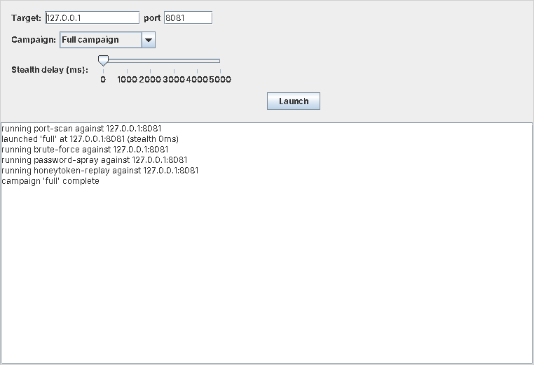

# Mirage — Deception-Based Intrusion Detection with Integrated Attack Simulation and Active Defense

**Course:** Object Oriented Design and Programming-II Laboratory (ICE-2206)

**Submitted by:**
- Nobo Ishraque — Roll 25549011082
- Adil Akhtab Abir — Roll 25549011096
- Noria Khan Sroti — Roll 25549011020

**Instructors:** Jasiya Fairiz Raisa (Lecturer, Dept. of ICT, BUP); Md. Shahariar Sarkar (Assistant Professor, Dept. of CSE, MIST)

**Submission date:** 14 October 2026

> The formatted master of this report, with all five rendered figures, lives here:
> https://claude.ai/code/artifact/f578aa80-d25b-4514-8adf-f03f27562c3b
> This Markdown copy is kept in the repo for version control.

## Abstract

Mirage is a network-defence system built around deception. Instead of trying to pick one
attacker out of millions of normal events, it deploys decoy services and bait files that no
legitimate user has any reason to touch, so that virtually every interaction with them is
hostile and every alert is high-confidence. The system is composed of three cooperating Java
applications: a central **Console** (the blue-team brain), lightweight **Sensors** that host
the decoys on each protected machine, and **Specter**, an integrated attack simulator (the red
team) used to drive and demonstrate the system inside an authorised lab network. When a Sensor
observes contact with a decoy, it streams the interaction to the Console, which builds a
per-source attacker profile, classifies the behaviour against the MITRE ATT&CK catalogue,
records it in a tamper-evident hash-chained ledger, and selects an active-defence response:
slowing the attacker with a tarpit, feeding fabricated data, or blocking the source across the
whole network. The project exercises the advanced-Java syllabus: TCP client–server
communication secured with TLS, extensive multithreading, a Swing dashboard, and an
object-oriented design organised around the Template Method, Strategy, Command, Observer and
Factory patterns.

## 1. Introduction

### 1.1 Overview

Traditional intrusion detection must separate rare attacks from overwhelming normal traffic,
which produces many false alarms and alert fatigue. Mirage takes the opposite approach, known
as **deception-based defence**: it plants decoys — fake services and bait files — that appear
valuable but serve no legitimate purpose. Because no real user has any reason to touch a decoy,
any contact with one is strong evidence of malicious activity. Mirage therefore turns a hard
detection problem into a simple one: watch the traps, and treat whoever touches them as an
intruder. **Sensors** host the decoys, the **Console** collects and acts on what they see, and
**Specter** plays the intruder so the team can build, test, and demonstrate the system safely.

### 1.2 Purpose and Significance

The purpose is to design and build a working deception-based detection and active-defence
platform that exercises the advanced Java topics of the course while teaching both the
defensive and offensive points of view. Deception is an established professional practice
(honeypots, honeytokens, products such as Thinkst Canary). Its significance: every alert is
high-confidence; decoys give early warning of reconnaissance, lateral movement, and ransomware;
and planted honeytokens reveal credential theft the moment they are used.

### 1.3 Scope

**In scope:** decoy services (fake HTTP admin login, FTP, Telnet/SSH banner), bait files,
honeytokens, a central Console with a Swing dashboard, attacker profiling, MITRE ATT&CK
classification, a tamper-evident hash-chained ledger, active-defence responses (tarpit, feed
fake data, network-wide block), and the Specter attack simulator.

**Safety boundary (important):** Mirage runs only inside a self-contained lab network of the
team's own machines/VMs. It never targets external or third-party systems. All active-defence
and simulated-attack actions are confined by an allowlist (`ScopeGuard`) to a declared lab
range, default-deny. The project does **not** perform real exploitation or denial-of-service of
outside hosts; the "turn it around on the attacker" behaviour is trapping, slowing, and
misleading the attacker on our own infrastructure — the lawful, standard form of active defence.

**Out of scope:** Mirage is an educational prototype, not a production IDS/IPS.

### 1.4 Contributions

| Member | Roll | Primary responsibility |
| --- | --- | --- |
| Nobo Ishraque | 25549011082 | Console server: TLS thread-pool networking, the producer–consumer pipeline, correlation + ATT&CK classification, and the hash-chained ledger. Integration lead. |
| Adil Akhtab Abir | 25549011096 | Sensor: the `Decoy` hierarchy and fake services, the bait-file watcher, the heartbeat monitor, and the active-response commands. |
| Noria Khan Sroti | 25549011020 | Specter simulator and its `ScopeGuard`, both Swing UIs, the embedded database and DAO layer, and the report. |

## 2. Methodology

### 2.1 Development Process

Iterative and incremental, one subsystem at a time, so there is always a running program to
demonstrate. Each member owns a feature branch; branches integrate weekly against agreed
interfaces. Increments: design → networking skeleton → decoys + detection → classification,
ledger, responses → Specter → Swing UIs → integration + lab testing. Core logic (ledger
hashing, detection rules, scope guard) is covered by JUnit tests.

### 2.2 Technologies and Tools

| Area | Choice |
| --- | --- |
| Language | Java 17 (built on JDK 21) |
| Networking | `java.net` sockets, TLS via `javax.net.ssl` |
| Concurrency | `java.util.concurrent` (thread pools, `BlockingQueue`, scheduled tasks) |
| UI | Java Swing (`SwingWorker`, custom-painted map) |
| Persistence | Embedded H2 via JDBC (DAO) |
| Integrity | SHA-256 (`java.security.MessageDigest`) for the ledger |
| Build/test | Maven + JUnit 5 |

### 2.3 Challenges and Solutions

- **Responsive UI** — all blocking work off the EDT, updates via `invokeLater`.
- **Thread-safe shared state** — single consumer owns all profile/ledger mutation.
- **Cross-sensor correlation** — aggregate events by source in a time window.
- **Safe, lawful active defence** — default-deny `ScopeGuard` before any outbound action.
- **Cheap tarpits** — slow single-byte handlers hold many connections.

## 3. Design

Figures are in the formatted proposal (link at the top).

### 3.1 System Architecture (Figure 1)

Hub and spoke: Sensors host decoys and watch bait files, opening one outbound TLS connection to
the Console; the Console accepts many Sensors on a thread pool, runs a producer–consumer
pipeline into the correlation/classification engine, writes the ledger and the database, and
drives the Swing dashboard; Specter attacks the Sensors' decoys from inside the lab range.

### 3.2 Component Responsibilities

| Component | Responsibility | Concurrency |
| --- | --- | --- |
| Console | Correlate, classify, keep ledger + DB, dashboard, issue responses | Connection pool + single consumer + scheduled heartbeat checker |
| Sensor | Host decoys, watch bait files, run response commands | Decoy pools + file-watch thread |
| Specter | Generate recon/brute/spray/honeytoken attacks on lab decoys | Pool of simulated attackers |

### 3.3 Object-Oriented Class Design (Figure 2 — UML)

Four families, each built on an abstraction: `Decoy` (Template Method) → fake services;
`DetectionRule` (Strategy) → rules; `ResponseAction` (Command) → responses; `AttackStrategy`
(Strategy) → attacks. Supported by `AttackerProfile`, `AlertLedger`/`LedgerEntry`, and an
`AlertBus` (Observer).

### 3.4 Design Patterns Used

| Pattern | Where | Why |
| --- | --- | --- |
| Template Method | `Decoy` | Fix the flow, vary the reply |
| Strategy | `DetectionRule`, `ResponsePolicy`, `AttackStrategy` | Pluggable algorithms |
| Command | `ResponseAction` | Queue/execute responses uniformly |
| Observer | `AlertBus` → dashboard | Decouple detection from UI |
| Producer–Consumer | network → `BlockingQueue` → engine | Safe concurrency |

### 3.5 Workflow: Detection to Response (Figure 3 — sequence)

Attacker touches a decoy → Sensor sends an `AttackEvent` over TLS → Console enqueues it → the
consumer updates the profile and runs the rules → a `Classification` is appended to the ledger
and the DB and pushed to the dashboard → `ResponsePolicy` chooses actions → `ScopeGuard`
approves the target → responses are sent to the Sensors (tarpit / feed fakes / block).

### 3.6 Database Design (Figure 4 — ER)

Embedded H2 via a DAO layer. Tables: `sensor`, `decoy`, `attack_event`, `attacker_profile`,
`alert` (hash-chained, with `prev_hash`/`hash`), `honeytoken`, `block_rule`. See
[`db/schema.sql`](db/schema.sql).

## 4. Implementation

The foundational code is in this repo under `src/main/java/com/mirage/`. Key pieces:

- **TLS thread-pool Console server** → to be added as `console.ConsoleServer` (see `HANDOVER.md`).
- **Decoy hierarchy (Template Method)** → `sensor/Decoy.java`, `sensor/FakeHttpLoginDecoy.java`.
- **Detection rules (Strategy)** → `console/detection/` (`BruteForceRule`, `PortScanRule`,
  `HoneytokenUseRule`).
- **Hash-chained ledger** → `console/AlertLedger.java` (SHA-256 link + `verify()`), tested in
  `src/test/java/com/mirage/AlertLedgerTest.java`.
- **Producer–consumer pipeline** → `console/CorrelationEngine.java`, `console/AlertBus.java`.
- **Scope-guarded responses (Command)** → `console/response/`, `console/ResponsePolicy.java`,
  and the safety boundary `common/ScopeGuard.java` (tested).
- **Specter (Strategy, scope-guarded)** → `specter/AttackStrategy.java`,
  `specter/BruteForceAttack.java`, `specter/Attacker.java`.

Representative snippet — the safety boundary that gates every outbound action:

```java
public void require(String ip) {
    if (!isAuthorised(ip)) {
        throw new SecurityException(ip + " is outside the authorised lab range");
    }
}
```

The full, compiling sources (with JUnit tests passing) are the authoritative reference.

## 5. Result

The user-facing deliverable is two Swing applications — the blue-team **Console dashboard**
and the red-team **Specter console** — and both are implemented. The screenshots below are
from the running build, captured on a headless display during a scripted demonstration. (To
regenerate them: `mvn compile && tools/screenshots/capture.sh`.)

### 5.1 Console dashboard (Figure 5)

The dashboard is a single window with four regions. A **network map** across the top shows
one node per source that has touched a decoy; a node starts grey and turns from green through
red as the worst alert raised against that source escalates. Down the left is the **live alert
feed**: one row per alert, newest first, colour-coded by severity (red CRITICAL, orange HIGH,
yellow MEDIUM, green LOW) and tagged with its MITRE ATT&CK technique. Selecting a row, or a
map node, fills the **attacker dossier / session replay / response** panel on the right. A
**status strip** along the bottom shows the alert count, the number of connected Sensors, and
the ledger state, next to a one-click **Verify ledger** control.


*Figure 5. The Console dashboard during the scripted run: the network map (four sources, one
still grey with no alert raised yet), the severity-coloured alert feed, and the attacker
dossier for the selected source (10.10.0.5) listing the services it probed and the passwords
it tried. The status strip reports six alerts, two connected Sensors, and a verified ledger.*

### 5.2 Specter console (Figure 6)

The operator picks a target in the authorised lab range, chooses a campaign (port scan,
brute-force, password spray, honeytoken replay, or a full campaign), sets a stealth slider,
and presses Launch. A live log shows each simulated attacker as it runs, and any target
outside the `ScopeGuard` range is refused before a packet leaves the console.



*Figure 6. The Specter red-team console running a full campaign against a lab target
(127.0.0.1:8081): target picker, campaign selector, and stealth slider above the live attack
log.*

### 5.3 Session replay and active response (Figure 7)

Selecting an alert, or clicking a node on the map, opens that source's detail view. The
**attacker dossier** lists the services it probed, the credentials and distinct passwords it
tried, and any honeytokens or bait files it touched. The **session replay** shows, in order,
exactly what the intruder sent at each decoy. The **responses** tab is a manual override:
alongside the automatic active defence — the `ResponsePolicy` issues a tarpit, fabricated
data, or a network-wide block by severity, enforced on the Sensor by its `ConnectionGate` —
the operator can issue those same commands by hand. Every command, automatic or manual,
passes `ScopeGuard` first, so nothing outside the lab range can ever be acted on.


*Figure 7. The detail view for a selected source. Top: the session replay — the exact port
probes and login attempts the intruder sent at each decoy. Bottom: the manual-override panel,
where the operator can tarpit, feed fake data, block, or unblock the source by hand; every
command is checked by ScopeGuard before it is sent.*

### 5.4 Ledger verification (Figure 8)

A one-click **Verify ledger** check walks the hash chain — each entry hashing the one before
it, each hash signed with ECDSA — and reports the result in the status strip: *verified*
while every link is intact, *BROKEN* the moment any stored alert is altered. When a link is
broken, the dashboard names the offending entry and highlights its row in red.


*Figure 8. The integrity check after one stored alert was altered on disk: the status strip
reads BROKEN (entry 2) and the tampered alert's row is highlighted in red in the feed. An
intact chain instead reads verified and highlights nothing.*

## Conclusion

Mirage reframes detection around deception to produce high-confidence alerts, and combines
profiling, ATT&CK classification, a tamper-evident ledger, and scoped active defence to both
explain and slow an attack. Pairing the Console with the Specter simulator makes the whole
system self-contained and demonstrable on the team's own machines, inside the authorised lab
range. Reflections on what was learned will be completed after implementation and testing.

## References

1. L. Spitzner, *Honeypots: Tracking Hackers*. Addison-Wesley, 2002.
2. N. Provos and T. Holz, *Virtual Honeypots*. Addison-Wesley, 2007.
3. The MITRE Corporation, "MITRE ATT&CK." https://attack.mitre.org
4. B. Goetz et al., *Java Concurrency in Practice*. Addison-Wesley, 2006.
5. E. Gamma et al., *Design Patterns*. Addison-Wesley, 1994.
6. Oracle, "Java Secure Socket Extension (JSSE) Reference Guide," Java SE 17 docs.
7. NIST, "FIPS 180-4: Secure Hash Standard," 2015.

## Appendices

- **A. Module layout** — see the "Project layout" section of [`README.md`](README.md).
- **B. Core classes** — the four pattern families under `src/main/java/com/mirage/`.
- **C. Lab setup and authorised scope** — run only on isolated host-only VMs or a lab VLAN;
  set the `ScopeGuard` CIDR to the lab range; generate the TLS keystore with `keytool`
  (keep `.jks` files out of git).
- **D. Build and run** — see [`README.md`](README.md).
