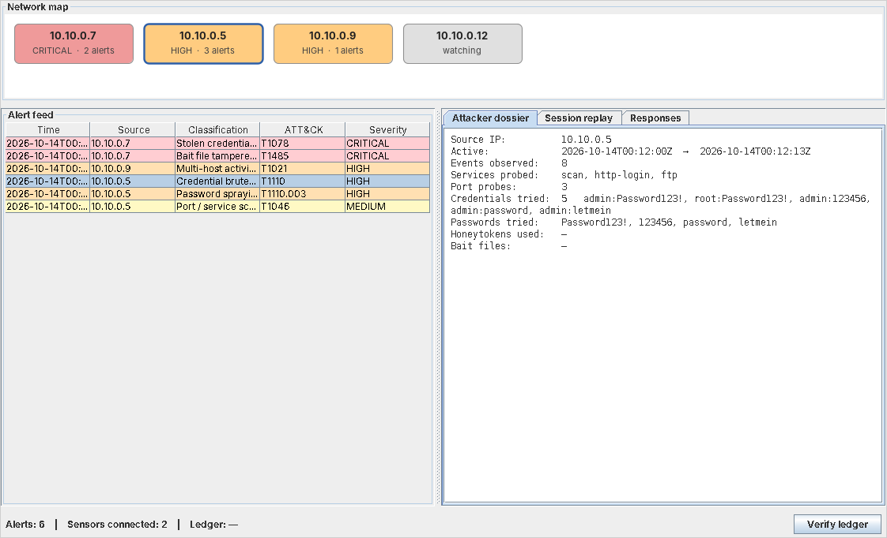
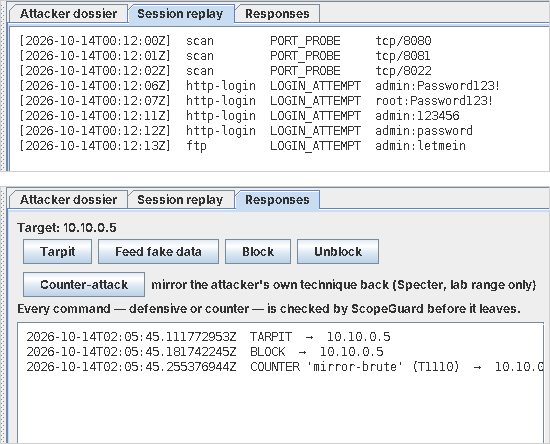
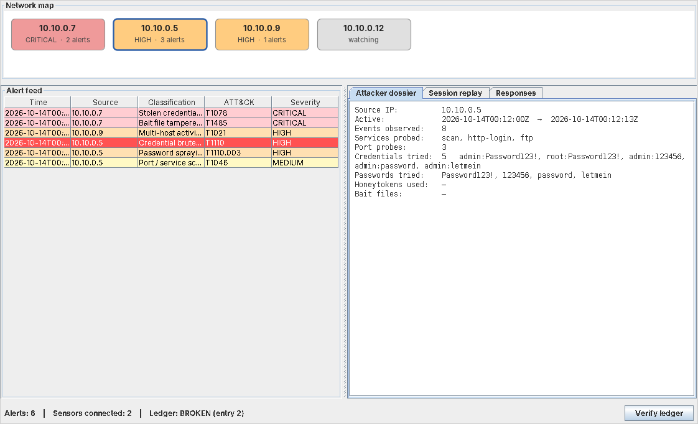
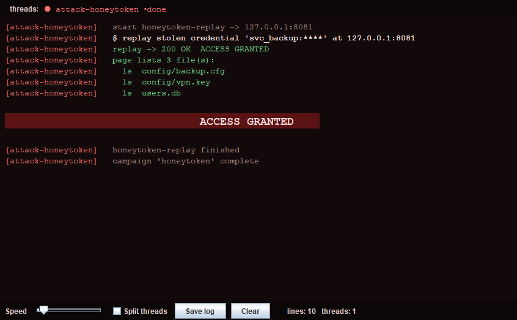
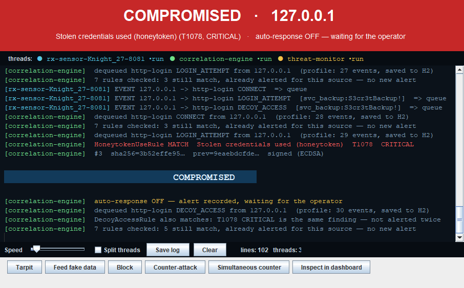
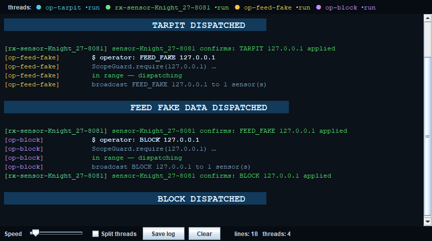
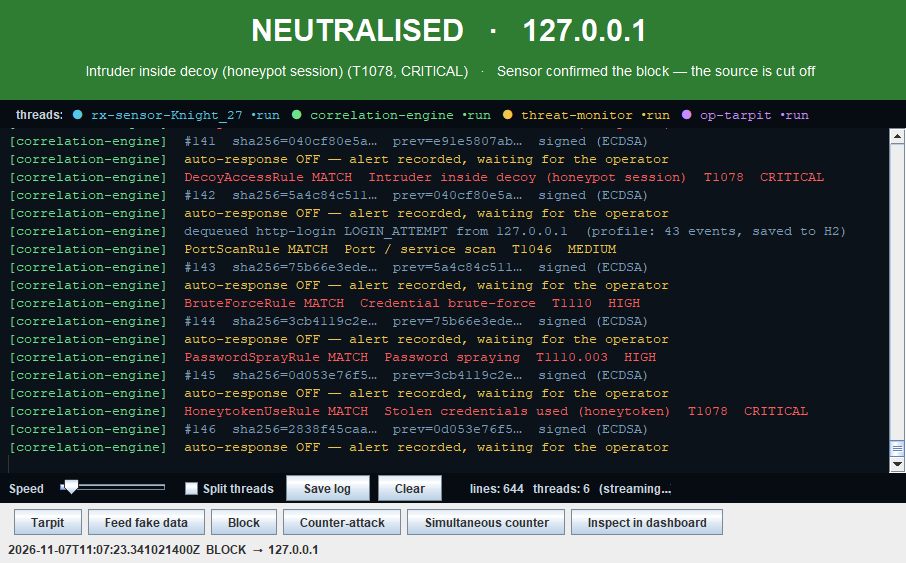
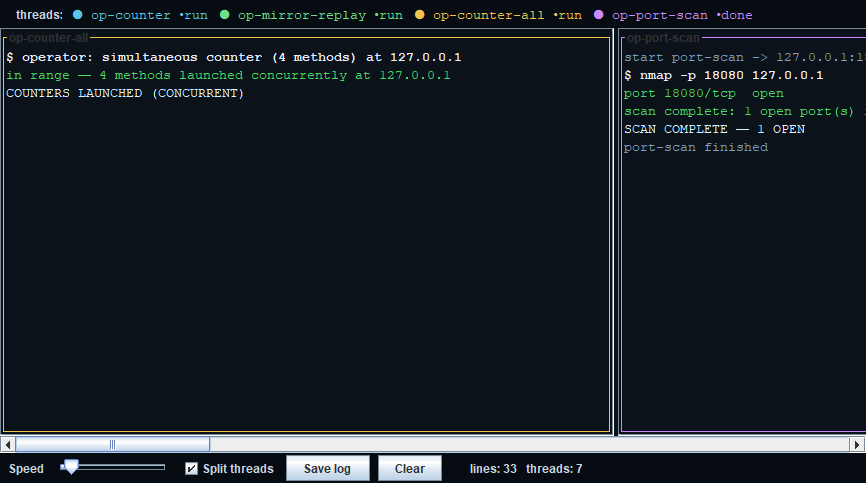
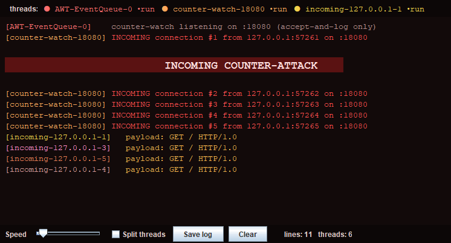

# Mirage — Deception-Based Intrusion Detection with Integrated Attack Simulation and Active Defense

**Course:** Object Oriented Design and Programming-II Laboratory (ICE-2206)

**Submitted by:**
- Nobo Ishraque — Roll 25549011082
- Adil Akhtab Abir — Roll 25549011096
- Noria Khan Sroti — Roll 25549011020

**Instructors:** Jasiya Fairiz Raisa (Lecturer, Dept. of ICT, BUP); Md. Shahariar Sarkar (Assistant Professor, Dept. of CSE, MIST)

**Submission date:** 14 October 2026

> The formatted master of this report, with all fourteen figures, lives here:
> https://claude.ai/artifact/7Hf6qAtuzF3i9TdU72jJgg (source: [`docs/report.html`](docs/report.html)).
> This Markdown copy is kept in the repo for version control.

## Abstract

Mirage is a network-defence system built around deception. Instead of trying to pick one
attacker out of millions of normal events, it deploys decoy services and bait files that no
legitimate user has any reason to touch, so that virtually every interaction with them is
hostile and every alert is high-confidence. The system is composed of three cooperating Java
applications: a central **Console** (the blue-team brain), lightweight **Sensors** that host
the decoys on each protected machine, and **Specter**, an integrated attack simulator (the red
team) used to drive and demonstrate the system inside an authorised lab network. When a Sensor
observes contact with a decoy, it streams the interaction to the Console, which builds a
per-source attacker profile, classifies the behaviour against the MITRE ATT&CK catalogue,
records it in a tamper-evident hash-chained ledger, and selects an active-defence response:
slowing the attacker with a tarpit, feeding fabricated data, or blocking the source across the
whole network. The project exercises the advanced-Java syllabus: TCP client–server
communication secured with TLS, extensive multithreading, a Swing dashboard, and an
object-oriented design organised around the Template Method, Strategy, Command, Observer and
Factory patterns.

## 1. Introduction

### 1.1 Overview

Traditional intrusion detection must separate rare attacks from overwhelming normal traffic,
which produces many false alarms and alert fatigue. Mirage takes the opposite approach, known
as **deception-based defence**: it plants decoys — fake services and bait files — that appear
valuable but serve no legitimate purpose. Because no real user has any reason to touch a decoy,
any contact with one is strong evidence of malicious activity. Mirage therefore turns a hard
detection problem into a simple one: watch the traps, and treat whoever touches them as an
intruder. **Sensors** host the decoys, the **Console** collects and acts on what they see, and
**Specter** plays the intruder so the team can build, test, and demonstrate the system safely.

### 1.2 Purpose and Significance

The purpose is to design and build a working deception-based detection and active-defence
platform that exercises the advanced Java topics of the course while teaching both the
defensive and offensive points of view. Deception is an established professional practice
(honeypots, honeytokens, products such as Thinkst Canary). Its significance: every alert is
high-confidence; decoys give early warning of reconnaissance, lateral movement, and ransomware;
and planted honeytokens reveal credential theft the moment they are used.

### 1.3 Scope

**In scope:** decoy services (fake HTTP admin login, FTP, Telnet/SSH banner), bait files,
honeytokens, a central Console with a Swing dashboard, attacker profiling, MITRE ATT&CK
classification, a tamper-evident hash-chained ledger, active-defence responses (tarpit, feed
fake data, network-wide block), and the Specter attack simulator.

**Safety boundary (important):** Mirage runs only inside a self-contained lab network of the
team's own machines/VMs. It never targets external or third-party systems. All active-defence
and simulated-attack actions are confined by an allowlist (`ScopeGuard`) to a declared lab
range, default-deny. The project does **not** perform real exploitation or denial-of-service of
outside hosts; the "turn it around on the attacker" behaviour is trapping, slowing, and
misleading the attacker on our own infrastructure — the lawful, standard form of active defence.

**Out of scope:** Mirage is an educational prototype, not a production IDS/IPS.

### 1.4 Contributions

| Member | Roll | Primary responsibility |
| --- | --- | --- |
| Nobo Ishraque | 25549011082 | Console server: TLS thread-pool networking, the producer–consumer pipeline, correlation + ATT&CK classification, and the hash-chained ledger. Integration lead. |
| Adil Akhtab Abir | 25549011096 | Sensor: the `Decoy` hierarchy and fake services, the bait-file watcher, the heartbeat monitor, and the active-response commands. |
| Noria Khan Sroti | 25549011020 | Specter simulator and its `ScopeGuard`, both Swing UIs, the embedded database and DAO layer, and the report. |

## 2. Methodology

### 2.1 Development Process

Iterative and incremental, one subsystem at a time, so there is always a running program to
demonstrate. Each member owns a feature branch; branches integrate weekly against agreed
interfaces. Increments: design → networking skeleton → decoys + detection → classification,
ledger, responses → Specter → Swing UIs → integration + lab testing. Core logic (ledger
hashing, detection rules, scope guard) is covered by JUnit tests.

### 2.2 Technologies and Tools

| Area | Choice |
| --- | --- |
| Language | Java 17 (runs on JDK 17+; CI tests on JDK 17) |
| Networking | `java.net` sockets, TLS via `javax.net.ssl` |
| Concurrency | `java.util.concurrent` (thread pools, `BlockingQueue`, scheduled tasks) |
| UI | Java Swing (`SwingWorker`, custom-painted map) |
| Persistence | Embedded H2 via JDBC (DAO) |
| Integrity | SHA-256 (`java.security.MessageDigest`) for the ledger |
| Build/test | Maven + JUnit 5 |

### 2.3 Challenges and Solutions

- **Responsive UI** — all blocking work off the EDT, updates via `invokeLater`.
- **Thread-safe shared state** — single consumer owns all profile/ledger mutation.
- **Cross-sensor correlation** — aggregate events by source in a time window.
- **Safe, lawful active defence** — default-deny `ScopeGuard` before any outbound action.
- **Cheap tarpits** — slow single-byte handlers hold many connections.

## 3. Design

Figures 1–4 are drawn in the formatted report (link at the top).

### 3.1 System Architecture (Figure 1)

Hub and spoke: Sensors host decoys and watch bait files, opening one outbound TLS connection to
the Console; the Console accepts many Sensors on a thread pool, runs a producer–consumer
pipeline into the correlation/classification engine, writes the ledger and the database, and
drives the Swing dashboard; Specter attacks the Sensors' decoys from inside the lab range.

### 3.2 Component Responsibilities

| Component | Responsibility | Concurrency |
| --- | --- | --- |
| Console | Correlate, classify, keep ledger + DB, dashboard, issue responses | Connection pool + single consumer + scheduled heartbeat checker |
| Sensor | Host decoys, watch bait files, run response commands | Decoy pools + file-watch thread |
| Specter | Generate recon/brute/spray/honeytoken attacks on lab decoys | Pool of simulated attackers |

### 3.3 Object-Oriented Class Design (Figure 2 — UML)

Four families, each built on an abstraction: `Decoy` (Template Method) → fake services;
`DetectionRule` (Strategy) → rules; `ResponseAction` (Command) → responses; `AttackStrategy`
(Strategy) → attacks. Supported by `AttackerProfile`, `AlertLedger`/`LedgerEntry`, and an
`AlertBus` (Observer).

### 3.4 Design Patterns Used

| Pattern | Where | Why |
| --- | --- | --- |
| Template Method | `Decoy` | Fix the flow, vary the reply |
| Strategy | `DetectionRule`, `ResponsePolicy`, `AttackStrategy` | Pluggable algorithms |
| Command | `ResponseAction` | Queue/execute responses uniformly |
| Observer | `AlertBus` → dashboard; `TraceBus` → process shells | Decouple detection (and its narration) from UI |
| Producer–Consumer | network → `BlockingQueue` → engine; workers → `ShellModel` → Swing timer | Safe concurrency; paced display |

### 3.5 Workflow: Detection to Response (Figure 3 — sequence)

Attacker touches a decoy → Sensor sends an `AttackEvent` over TLS → Console enqueues it → the
consumer updates the profile and runs the rules → a `Classification` is appended to the ledger
and the DB and pushed to the dashboard → `ResponsePolicy` chooses actions → `ScopeGuard`
approves the target → responses are sent to the Sensors (tarpit / feed fakes / block).

### 3.6 Database Design (Figure 4 — ER)

Embedded H2 via a DAO layer. Tables: `sensor`, `attack_event`, `attacker_profile`,
`alert` (hash-chained, with `prev_hash`/`hash`, signed by a key kept in `data/` and continued
across restarts), `honeytoken`, `block_rule`. See [`db/schema.sql`](db/schema.sql).

## 4. Implementation

The foundational code is in this repo under `src/main/java/com/mirage/`. Key pieces:

- **TLS thread-pool Console server** → `console/ConsoleServer.java` (TLS when a keystore is configured; one receive thread per Sensor).
- **Decoy hierarchy (Template Method)** → `sensor/Decoy.java`, `sensor/FakeHttpLoginDecoy.java`.
- **Detection rules (Strategy)** → `console/detection/` (`BruteForceRule`, `PortScanRule`,
  `HoneytokenUseRule`).
- **Hash-chained ledger** → `console/AlertLedger.java` (SHA-256 link + `verify()`), tested in
  `src/test/java/com/mirage/AlertLedgerTest.java`.
- **Producer–consumer pipeline** → `console/CorrelationEngine.java`, `console/AlertBus.java`.
- **Scope-guarded responses (Command)** → `console/response/`, `console/ResponsePolicy.java`,
  and the safety boundary `common/ScopeGuard.java` (tested).
- **Specter (Strategy, scope-guarded)** → `specter/AttackStrategy.java`,
  `specter/BruteForceAttack.java`, `specter/Attacker.java`.

Representative snippet — the safety boundary that gates every outbound action:

```java
public void require(String ip) {
    if (!isAuthorised(ip)) {
        throw new SecurityException(ip + " is outside the authorised lab range");
    }
}
```

The full, compiling sources (299 JUnit tests passing) are the authoritative reference.

## 5. Result

The user-facing deliverable is two Swing applications — the blue-team **Console dashboard**
and the red-team **Specter console** — and both are implemented. The screenshots below are
from the running build, captured on a headless display during a scripted demonstration. (To
regenerate them: `mvn compile && tools/screenshots/capture.sh`.)

### 5.1 Console dashboard (Figure 5)

The dashboard is a single window with four regions. A **network map** across the top shows
one node per source that has touched a decoy; a node starts grey and turns from green through
red as the worst alert raised against that source escalates. Down the left is the **live alert
feed**: one row per alert, newest first, colour-coded by severity (red CRITICAL, orange HIGH,
yellow MEDIUM, green LOW) and tagged with its MITRE ATT&CK technique. Selecting a row, or a
map node, fills the **attacker dossier / session replay / response** panel on the right. A
**status strip** along the bottom shows the alert count, the number of connected Sensors, and
the ledger state, next to a one-click **Verify ledger** control.



*Figure 5. The Console dashboard during the scripted run: the network map (four sources, one
still grey with no alert raised yet), the severity-coloured alert feed, and the attacker
dossier for the selected source (10.10.0.5) listing the services it probed and the passwords
it tried. The status strip reports six alerts, two connected Sensors, and a verified ledger.*

### 5.2 Specter console (Figure 6)

The operator picks a target in the authorised lab range, chooses a campaign (port scan,
brute-force, password spray, honeytoken replay, or a full campaign), sets a stealth slider,
and presses Launch. A live log shows each simulated attacker as it runs, and any target
outside the `ScopeGuard` range is refused before a packet leaves the console.


*Figure 6. The Specter red-team console running a full campaign against a lab target
(127.0.0.1:8081): target picker, campaign selector, and stealth slider above the live attack
log.*

### 5.3 Session replay and active response (Figure 7)

Selecting an alert, or clicking a node on the map, opens that source's detail view. The
**attacker dossier** lists the services it probed, the credentials and distinct passwords it
tried, and any honeytokens or bait files it touched. The **session replay** shows, in order,
exactly what the intruder sent at each decoy. The **responses** tab is a manual override:
alongside the automatic active defence — the `ResponsePolicy` issues a tarpit, fabricated
data, or a network-wide block by severity, enforced on the Sensor by its `ConnectionGate` —
the operator can issue those same commands by hand, and can launch a **counter-attack** that
reads the source's detected technique and turns that same method back on them
(`console.CounterOffensive` + `MirrorCounterStrategy`), or a **simultaneous counter** that runs
every counter technique at once, each on its own thread (`Attacker.launchConcurrent`), so the
source faces several methods in parallel — a direct use of the project's multithreading.
Every command — defensive or counter, automatic or manual — passes `ScopeGuard` first, so a
counter can only ever reach a source inside the lab range; a real external address is refused.
This is a controlled, in-range demonstration of "turning it around", not a hack-back.



*Figure 7. The detail view for a selected source. Top: the session replay — the exact port
probes and login attempts the intruder sent at each decoy. Bottom: the responses panel; the
detected brute-force (T1110) is mirrored back as a `mirror-brute` counter-attack, and
`COUNTER-ALL` runs all four methods against the source at once, each on its own thread. Every
command is checked by ScopeGuard before it leaves.*

### 5.4 Ledger verification (Figure 8)

A one-click **Verify ledger** check walks the hash chain — each entry hashing the one before
it, each hash signed with ECDSA — and reports the result in the status strip: *verified*
while every link is intact, *BROKEN* the moment any stored alert is altered. When a link is
broken, the dashboard names the offending entry and highlights its row in red.



*Figure 8. The integrity check after one stored alert was altered on disk: the status strip
reads BROKEN (entry 2) and the tampered alert's row is highlighted in red in the feed. An
intact chain instead reads verified and highlights nothing.*

### 5.5 Live process shells and the two-host demo (Figures 9–14)

The final iteration makes the system's work *visible* as it happens, and splits the demo across
two machines: **Laptop A** (the protected host) runs the Console and the Sensor, and
**Laptop B** runs Specter. Both ship as one runnable jar
(`java -jar mirage.jar defender | attacker`). The lab range becomes configurable so the two
laptops can share a private LAN. A new start-up check, `ScopeGuard.requireLabRange`, refuses any
range that is not private or loopback and `/16` or narrower, so the boundary can be moved but
never widened onto the internet.

**Process shells.** Every component narrates its steps as `TraceEvent`s (time, channel, thread,
stage, source, level, text) on a `TraceBus`, an Observer just like the `AlertBus`. Terminal-style
shells subscribe and draw each line tagged and coloured by the thread that produced it, with a
live thread strip on top. When several threads work at once, the shell splits into one pane per
thread. The shell's model is a paced producer–consumer queue: worker threads add lines, a Swing
timer drains a few at a time, so a sub-second scan still reads clearly. Pacing only delays the
display, never the work. On Specter, each launch opens its own shell and ends with a banner
derived from the decoy's real reply. A strategy reads that reply through `ProbeReply`:
*accepted*, *rejected*, *reset* (blocked), *no reply*, or *timed out* (tarpit). The banners are
therefore honest outcomes, not guesses (Figure 9).



*Figure 9. Specter on Laptop B replays the planted credential. The HTTP decoy accepts this one
trap credential and serves a canned "admin page", so the attacker sees ACCESS GRANTED, but
nothing real stands behind it.*

**Threat popup.** On the Console, the first alert from a source opens a popup whose banner
escalates with the worst severity seen: **PROBE DETECTED → UNDER ATTACK → COMPROMISED**. Beneath
it, a shell shows the Console's own pipeline for that source: the receive thread queuing the
event, the correlation engine dequeuing it, each rule's verdict, the ledger entry's hash and
ECDSA signature, and the response decision. Because the popup opens *after* the alert that
triggered it, a bounded `TraceBacklog` replays the lines it missed before going live, with no gap
and no duplicate. Each rule raises an alert once per source and again only if its severity
rises, so the ledger holds one entry per finding rather than one per packet (Figure 10).



*Figure 10. The Console's threat popup for the intruder: COMPROMISED (stolen credential,
T1078, CRITICAL; the decoy-session rule confirms it without a second alert), with the pipeline
shell beneath. Auto-response is
off, so the alert is recorded and the Console waits for the operator.*

**Operator-gated response.** A shared `AutoResponse` switch decides whether the `ResponsePolicy`
acts on its own. In the demo it is off, so the operator answers from the popup. Each action
opens an *operation shell* and runs on a worker thread named after it (`op-tarpit`,
`op-block`, …). The shell shows the operator's command, the `ScopeGuard` check, the broadcast to
the Sensors, and each Sensor's **ACK**, a new wire message sent once the command is applied
(Figure 11). The ACK of a block moves the popup to **NEUTRALISED** (Figure 12), and on Laptop B
the next attempt reads *CONNECTION BLOCKED*. A blocked decoy rejects with a TCP reset, which
the attacker's prober tells apart from a peer that closes without answering. Ticking
*Auto-response* restores fully automatic defence.



*Figure 11. The defence operation shell. Each command is tagged with its own thread
(`op-tarpit`, `op-feed-fake`, `op-block`), passes ScopeGuard, is broadcast, and is confirmed by
the Sensor's receive thread.*



*Figure 12. The popup turns NEUTRALISED only when a Sensor confirms the block (its ACK), not
when the command is merely sent.*

**Counters, seen from both ends.** The counter-offensive of §5.3 now shows both sides. On the
Console, *Simultaneous counter* opens a counter shell split into one pane per counter thread,
running a bounded set of four techniques at once (Figure 13). On Laptop B, a passive
`CounterWatch` listener accepts and logs each incoming connection and raises an **INCOMING
COUNTER-ATTACK** banner (Figure 14). It never sends anything back, so the counter's probes end
in *NO REPLY*. Both directions remain confined to the lab range by `ScopeGuard`.



*Figure 13. The counter operation shell in split view: the operator's command on `op-counter-all`
and each counter technique on its own thread, all running concurrently.*



*Figure 14. Laptop B's counter-watch: every incoming connection, its source port and the first
line it carried, on its own thread. It is accept-and-log only.*

**Verification.** Besides 299 unit tests, the whole demo is exercised by an automated GUI dry run
(`tools/screenshots/LiveDemoShot.java`). It starts the real Console, Sensor and Specter, presses
their buttons the way the presenters would, and checks 28 outcomes: every campaign, every
operator action (including fake data letting the attacker "in" to worthless files), auto-response
on and off, a counter reaching the counter-watch, and an out-of-range target being refused.
Figures 9–14 come from that run.

**Stress test.** Two independent reviews then tested the build for security and robustness:
floods, idle and malformed connections, lost links, skewed clocks, restarts, and mistyped
settings. Every finding was fixed, each with a test that failed before the fix
(`docs/stress-test/CHECKLIST.md`). Among them: the Sensor link uses mutual TLS between machines
and fails closed; the ledger's signing key and hash chain survive restarts; the detection rules
count within time windows; and a Sensor that stops reading can no longer stall the Console.

## Conclusion

Mirage reframes detection around deception to produce high-confidence alerts, and combines
profiling, ATT&CK classification, a tamper-evident ledger, and scoped active defence to both
explain and slow an attack. Pairing the Console with the Specter simulator makes the whole
system self-contained and demonstrable on the team's own machines, inside the authorised lab
range. Reflections on what was learned will be completed after implementation and testing.

## References

1. L. Spitzner, *Honeypots: Tracking Hackers*. Addison-Wesley, 2002.
2. N. Provos and T. Holz, *Virtual Honeypots*. Addison-Wesley, 2007.
3. The MITRE Corporation, "MITRE ATT&CK." https://attack.mitre.org
4. B. Goetz et al., *Java Concurrency in Practice*. Addison-Wesley, 2006.
5. E. Gamma et al., *Design Patterns*. Addison-Wesley, 1994.
6. Oracle, "Java Secure Socket Extension (JSSE) Reference Guide," Java SE 17 docs.
7. NIST, "FIPS 180-4: Secure Hash Standard," 2015.

## Appendices

- **A. Module layout** — see the "Project layout" section of [`README.md`](README.md).
- **B. Core classes** — the four pattern families under `src/main/java/com/mirage/`.
- **C. Lab setup and authorised scope** — run only on isolated host-only VMs or a lab VLAN;
  set the `ScopeGuard` CIDR to the lab range; generate the TLS keystore with `keytool`
  (keep `.jks` files out of git).
- **D. Build and run** — see [`README.md`](README.md).
