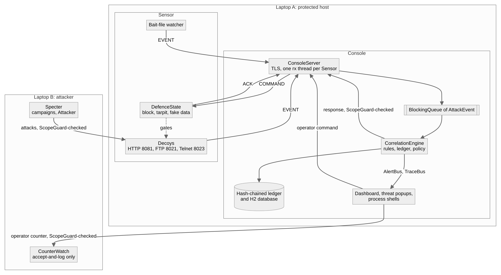
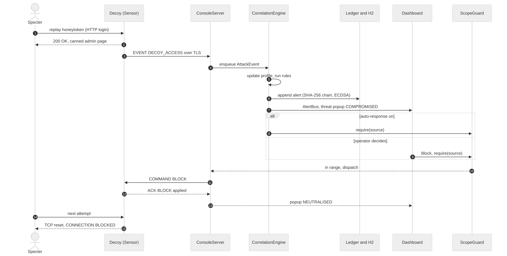
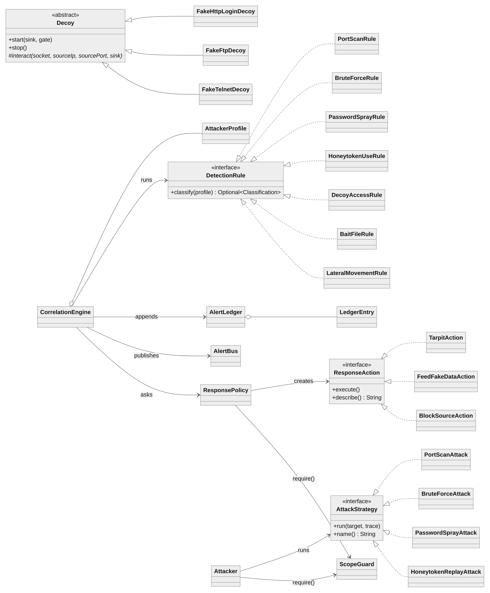
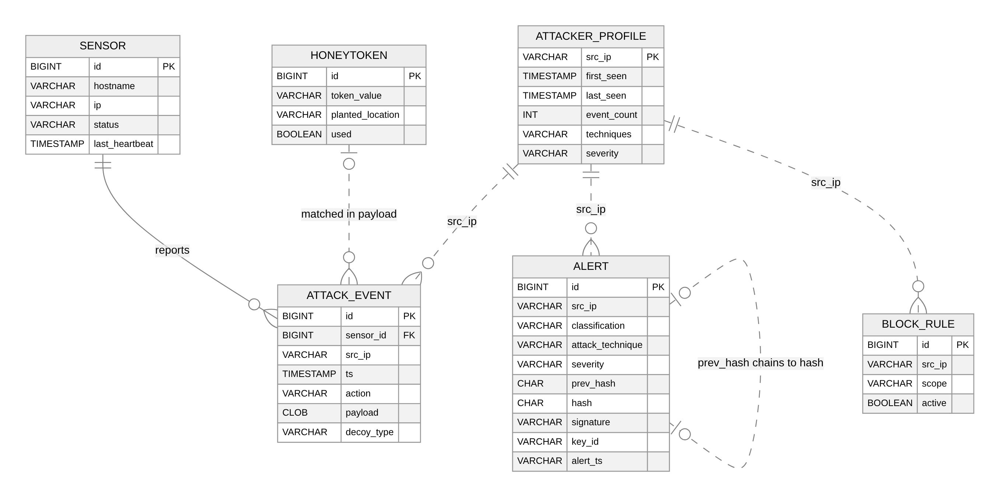
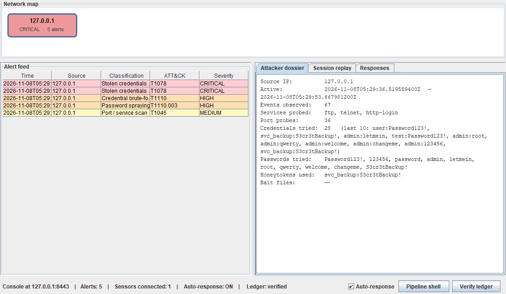
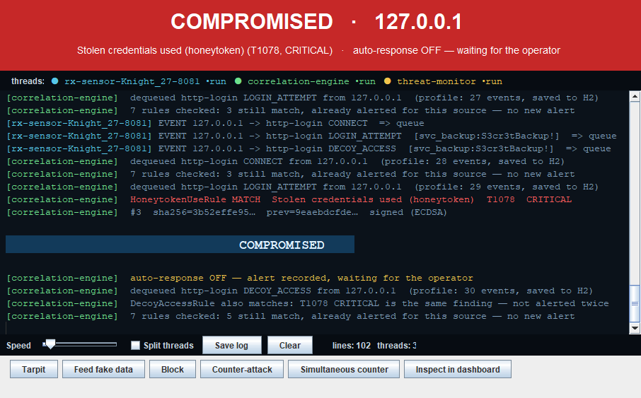

# Mirage: the complete guide

*A walk through the whole project: what it does, how it runs, how the code is organised, and
which Object Oriented Design and Programming (OODP) concept is used where, and why.*

Course: Object Oriented Design and Programming-II Laboratory (ICE-2206) · Team: Nobo Ishraque,
Adil Akhtab Abir, Noria Khan Sroti · Last updated 17 November 2026

---

## How to use this guide

- **New to the project?** Read parts 1 to 3 in order. They explain the idea, how to run it and
  how one attack moves through the system.
- **Preparing for a viva or a code question?** Part 5 is the core. It takes each OODP topic
  (classes, inheritance, interfaces, threads, Swing, JDBC, patterns and so on) and shows the exact
  classes that use it and why that choice was made. Part 13 has likely questions with short
  answers.
- **Looking for a class?** Part 4 is a package-by-package map.

All class names are relative to `src/main/java/com/mirage/`. For example, `sensor.Decoy` is
`src/main/java/com/mirage/sensor/Decoy.java`.

---

## Part 1. Mirage in one page

### The problem

A normal intrusion-detection system (IDS) looks at all network traffic and tries to pick out the
few malicious actions among millions of normal ones. It raises many false alarms, people stop
trusting it ("alert fatigue"), and real attacks get lost.

### The idea: deception

Mirage plants **traps** that no legitimate user has any reason to touch:

- **Decoys:** fake network services (a router-style web login, FTP and Telnet) that look real.
- **Bait files:** fake valuable files (`passwords.csv`, `vpn.key`, `config/backup.cfg`).
- **Honeytokens:** a planted fake credential (`svc_backup:S3cr3tBackup!`). Nobody should ever use it.

Because nobody legitimate touches a trap, **any contact is a high-confidence alert**. The hard
problem ("find the attacker in the noise") becomes an easy one ("watch the traps").

### Three applications

| App | Team | What it does |
| --- | --- | --- |
| **Sensor** | defender's machine | Runs the decoys and the bait-file watcher. Reports every touch to the Console and carries out the Console's responses (block, tarpit, fake data). |
| **Console** | blue team | The brain. Receives events, builds a profile per attacker, classifies behaviour with MITRE ATT&CK rules, records alerts in a tamper-evident ledger and a database, shows everything in a Swing dashboard, and responds. |
| **Specter** | red team | Our own built-in attacker: port scan, brute force, password spray, honeytoken replay. It drives the demo. A "counter-watch" window shows counter-attacks arriving. |

### The safety rule

Everything that leaves a program (an attack, a response, a counter-attack) first passes
**`ScopeGuard`**, which allows only addresses inside the configured **lab range**. The lab range
must itself be private (10/8, 172.16/12, 192.168/16) or loopback (127/8) and no wider than /16, or
the program refuses to start. Mirage can never touch the internet.

### The demo story (what the video and the live demo show)

1. Specter **scans** → the Console pops up *PROBE DETECTED* (port scan, T1046).
2. Specter **brute-forces** the login → *UNDER ATTACK* (T1110).
3. Specter **replays the stolen honeytoken** → the decoy lets it "in" to a fake admin page →
   *COMPROMISED* (T1078, CRITICAL).
4. The operator answers: **Tarpit** (attacker stalls), **Feed fake data** (attacker "gets in"
   to worthless files), **Block** (attacker gets a TCP reset). The popup turns *NEUTRALISED*
   only when the Sensor confirms.
5. The operator **counter-attacks**: the attacker's own technique, mirrored back, lab range only.
6. **Verify ledger** proves no alert was altered. A target outside the lab is **refused**.

---

## Part 2. Running it

Maven is not needed on the laptop. Use the **Maven Wrapper** in the repository.

```text
./mvnw test                       # compile and run all 299 tests   (Windows: mvnw.cmd test)
./mvnw -DskipTests package        # build the runnable jar: target/mirage.jar
java -jar target/mirage.jar defender   # Laptop A: Console + Sensor  (or run-defender.bat)
java -jar target/mirage.jar attacker   # Laptop B: Specter + counter-watch (or run-attacker.bat)
```

`Launcher` reads the first word (the **role**) with a `switch` and starts the right `main`
methods: `defender`, `attacker`, `console`, `sensor`, `help`.

**Settings** come from `common.LabConfig`, in rising priority: built-in defaults, a
`mirage.properties` file in the working folder, then command-line flags (`--lab-cidr`,
`--console-host`, `--console-port`, `--http-port`, …). Defaults keep everything on
`127.0.0.1`, so one laptop works out of the box.

| Port | Used by |
| --- | --- |
| 8443 | Console (Sensors connect here) |
| 8081 / 8021 / 8023 | HTTP, FTP, Telnet decoys |
| 8080 | Specter's counter-watch |

**Optional passwords** (environment variables): `MIRAGE_LEDGER_PASSWORD` (protects the ledger
signing key), `MIRAGE_DB_PASSWORD` (encrypts the H2 database), `MIRAGE_TLS_PASSWORD` (the TLS
keystores).

**More documents:** two laptops: `docs/TWO-LAPTOP-SETUP.md`; demo script: `DEMO.md`; report:
`docs/submission/`; GUI dry run: `tools/screenshots/README.md`.

---

## Part 3. The architecture and the life of one attack



*Figure 1. Hub and spoke. Each Sensor keeps one connection to the Console. Every arrow that
leaves a process passes ScopeGuard.*

### Follow one attack through the code

This is the honeytoken replay from the demo, step by step, with the class that does each step.

| # | What happens | Where (class) | Concept used |
| --- | --- | --- | --- |
| 1 | Specter checks the target is in the lab range, then starts the attack on a pool thread | `specter.Attacker` → `ScopeGuard.require` | exceptions, thread pool |
| 2 | The attack sends an HTTP login with the stolen credential | `specter.HoneytokenReplayAttack` | Strategy, sockets |
| 3 | The decoy's accept loop takes the connection and asks the gate what to do | `sensor.Decoy` (`acceptLoop`, `dispatch`) + `sensor.DefenceState` | Template Method, `ServerSocket` |
| 4 | The HTTP decoy sees a trap credential, reports `LOGIN_ATTEMPT` and `DECOY_ACCESS`, and serves a fake admin page | `sensor.FakeHttpLoginDecoy.interact` | inheritance, overriding |
| 5 | The Sensor turns each event into one JSON line and sends it over TLS | `sensor.SensorLink`, `sensor.SensorClient`, `common.JsonCodec` | sockets, TLS, JSON |
| 6 | A Console receive thread reads the line, validates it, and puts the event on a queue | `console.ConsoleServer`, `console.EventValidator` | producer, `BlockingQueue` |
| 7 | The single engine thread takes it, updates the attacker's profile, runs every rule | `console.CorrelationEngine`, `common.AttackerProfile` | consumer, polymorphism |
| 8 | `HoneytokenUseRule` returns *Stolen credentials used*, T1078, CRITICAL | `console.detection.HoneytokenUseRule` | Strategy, `Optional` |
| 9 | The alert is hashed, chained, signed, and saved | `console.AlertLedger`, `console.KeyPairSigner`, `console.H2Persistence` → `console.db.AlertDao` | SHA-256, ECDSA, JDBC |
| 10 | The alert is published; the dashboard and threat popup update | `console.AlertBus`, `common.trace.TraceBus` → `console.ui.Dashboard`, `ThreatPopup` | Observer, Swing |
| 11 | The operator clicks **Block**; it runs on thread `op-block` | `console.ui.OperationShells` → `console.ResponseController` | threads, Command |
| 12 | `BlockSourceAction` broadcasts a `COMMAND` to every Sensor | `console.response.BlockSourceAction`, `ConsoleServer.broadcast` | Command pattern |
| 13 | The Sensor marks the source blocked and replies `ACK` | `sensor.DefenceState`, `sensor.SensorLink` | |
| 14 | The ACK turns the popup green: NEUTRALISED | `console.ThreatTracker`, `ThreatPopup` | Observer, enum state |
| 15 | Specter tries again and gets a TCP reset: CONNECTION BLOCKED | `Decoy.closeWithReset`, `specter.ProbeReply` | sockets (`SO_LINGER` 0) |



*Figure 2. The same flow as a sequence diagram.*

### What decides the automatic response

When **Auto-response** is on (always on when there is no GUI), `console.ResponsePolicy` picks a
response from the severity:

| Severity | Response | What the attacker experiences |
| --- | --- | --- |
| LOW, MEDIUM | **Tarpit** | The decoy drips one byte at a time: the attack stalls |
| HIGH | **Feed fake data** | Any password "works" and shows fake files |
| CRITICAL | **Block** | Every Sensor resets the connection |

In the GUI demo it is **off**, so the operator decides from the popup.

---

## Part 4. Package-by-package map

116 source files, about 10,000 lines.

| Package | Files | What lives there |
| --- | --- | --- |
| `(root)` | 1 | `Launcher`: the jar's entry point, picks the role |
| `common` | 22 | Shared value types (records), enums, `ScopeGuard`, `LabConfig`, `JsonCodec`, TLS factories, line reader, time-window counters |
| `common.trace` | 5 | `TraceEvent`, `TraceBus`, `TraceBacklog`, `TraceSink`: the lines the shells show |
| `console` | 25 | `ConsoleMain`, `ConsoleServer`, `CorrelationEngine`, `AlertLedger`, `ResponsePolicy`, `CounterOffensive`, registries and stores |
| `console.detection` | 8 | `DetectionRule` and the seven rules |
| `console.response` | 4 | `ResponseAction` and the three responses |
| `console.db` | 7 | `Database` and the six DAO classes |
| `console.ui` | 13 | `Dashboard`, `ThreatPopup`, `NetworkMapPanel`, `AttackerDetailPanel`, `AlertTableModel`, `OperationShells` |
| `sensor` | 12 | `Decoy` and three fake services, `DefenceState`, `BaitFileWatcher`, `SensorLink`, `SensorClient`, `SensorMain` |
| `specter` | 15 | `Attacker`, four attack strategies, `Campaign(s)`, `ProbeReply`, `CounterWatch`, `SpecterConsole` |
| `ui.shell` | 4 | `ShellModel`, `ShellWindow`, `ShellTheme`, `ShellDocuments`: the terminal-style shells |

### The most important classes, in one line each

| Class | Job |
| --- | --- |
| `common.ScopeGuard` | The safety boundary: `require(ip)` throws unless the IP is inside the lab range |
| `common.AttackerProfile` | Everything one source has done, with counts inside time windows |
| `sensor.Decoy` | Abstract base of every fake service: accept, gate, serve on a bounded pool |
| `sensor.DefenceState` | The Sensor's memory of who is blocked, tarpitted or fed fake data |
| `console.ConsoleServer` | Accepts Sensors, reads events, broadcasts commands, one writer per Sensor |
| `console.CorrelationEngine` | The single consumer thread: profiles, rules, ledger, alerts, responses |
| `console.AlertLedger` | Append-only, SHA-256 hash-chained, ECDSA-signed list of alerts |
| `console.ResponsePolicy` | Severity → response (Strategy), after ScopeGuard |
| `console.CounterOffensive` | Mirrors the attacker's technique back, single or all at once |
| `specter.Attacker` | Runs a campaign's strategies one by one or concurrently, after ScopeGuard |
| `specter.ProbeReply` | Reads a decoy's reply and names the outcome honestly |
| `ui.shell.ShellModel` | The GUI-free core of a shell: a paced queue of lines, one lane per thread |

---

## Part 5. OODP concepts: where and why

Each section answers three questions: **what is it, where is it in Mirage, and why was it used
there.**

### 5.1 Classes, objects and encapsulation

**What:** a class bundles data with the methods that act on it, and hides the data
(`private`) so other code can only use the public methods.

**Where and why:**

- `common.ScopeGuard` keeps its list of allowed networks `private` and exposes only
  `isAuthorised(ip)` and `require(ip)`. Nobody can add a network to it after it is built, so the
  safety boundary cannot be changed from outside.
- `console.AlertLedger` keeps its chain `private`. The only way to add is `append()`, which
  always computes the hash and signature. `entries()` returns an **unmodifiable copy**, so callers
  cannot edit the ledger.
- `common.AttackerProfile` hides its counters behind methods such as
  `recentPasswordsOnOneAccount()`. The rules ask questions; they never touch the data structures.
- Almost every class is `final` (it cannot be subclassed) unless it was designed for inheritance.
  This keeps behaviour predictable. `Decoy` is the planned exception.

### 5.2 Inheritance and abstract classes

**What:** a subclass `extends` a parent class, reuses its code and overrides some methods. An
`abstract` class cannot be created on its own; it leaves some methods for subclasses.

**Where and why:**

- **`sensor.Decoy` (abstract)** → `FakeHttpLoginDecoy`, `FakeFtpDecoy`, `FakeTelnetDecoy`.
  All decoys need the same hard part: open a `ServerSocket`, accept connections, check the
  gate, run each connection on a bounded thread pool, enforce time limits, reset blocked
  sources. That is written **once** in `Decoy`. Each subclass writes only the conversation:
  `interact()` (abstract, must be written) and `feedFake()` (optional override).
- **Swing classes**: `Dashboard`, `ThreatPopup` and `SpecterConsole` extend `JFrame` (a window).
  `NetworkMapPanel` and `ShellWindow` extend `JPanel`. `AlertTableModel` extends
  `AbstractTableModel`. `WrapLayout` extends `FlowLayout`. Inheritance is how Swing is meant to be
  customised.
- **Exceptions**: `common.LineTooLongException extends IOException`, so a too-long line is
  handled by the same `catch (IOException)` code that handles a dropped connection.

```java
public abstract class Decoy {
    public final synchronized void start(Consumer<AttackEvent> sink, ConnectionGate gate) { ... }
    protected abstract void interact(Socket s, String ip, int port, Consumer<AttackEvent> sink)
            throws IOException;
    protected void feedFake(Socket s, String ip, int port, Consumer<AttackEvent> sink)
            throws IOException { interact(s, ip, port, sink); }   // default: behave normally
}
```

`start()` is `final`, so no subclass can break the safety and limit logic.

### 5.3 Interfaces and polymorphism

**What:** an interface is a contract (method signatures). Many classes can implement it, and
code that holds the interface type works with any of them. Calling the same method on different
objects and getting different behaviour is **polymorphism**.

**The 11 interfaces in Mirage:**

| Interface | Implementations | Why an interface |
| --- | --- | --- |
| `DetectionRule` | 7 rules | The engine loops over `List<DetectionRule>` and never knows which rule it is calling |
| `ResponseAction` | Tarpit, FeedFakeData, BlockSource | Responses are objects that can be run the same way |
| `AttackStrategy` | 4 attacks | `Attacker` runs any strategy |
| `CounterStrategy` | `MirrorCounterStrategy` | How to choose a counter can be swapped |
| `ConnectionGate` | `DefenceState`, `ALLOW_ALL` | The decoy asks "what do I do with this IP?" without knowing who decides |
| `CommandSink` | `ConsoleServer`, test fakes | Responses send through it; tests capture commands instead of using a network |
| `Persistence` | `H2Persistence`, `NONE` | The engine saves through it; tests run without a database |
| `LedgerSigner` | `KeyPairSigner`, `NONE` | Signing is optional |
| `TraceSink` | `TraceBus`, `NONE` | Components narrate their steps; headless runs pay nothing |
| `AttackTrace` | lambdas | A strategy reports each step to the right shell |
| `OperationRunner` | `OperationShells`, plain runner | Operator actions run inline or in a shell |

The `NONE` constants are the **Null Object** pattern: an implementation that does nothing, so the
code never needs `if (x != null)` checks.

Polymorphism in action, in `CorrelationEngine.process`:

```java
for (DetectionRule rule : rules) {               // 7 different classes, one loop
    Optional<Classification> hit = rule.classify(profile);
    ...
}
```

Adding an eighth rule means writing one class and adding it to the list in `ConsoleMain`. The
engine does not change: this is the **open/closed principle**.

### 5.4 Records and immutability

**What:** a Java `record` is a short way to write an immutable data class. Its fields are final
and it gets a constructor, getters, `equals`, `hashCode` and `toString` for free.

**Where:** `Alert`, `AttackEvent`, `Classification`, `LedgerEntry`, `Honeytoken`,
`ResponseCommand`, `SensorMessage`, `TraceEvent`, `AttackerSnapshot`, `Target`, `DecoyLimits`,
`LiveOptions`, plus small private ones (`Cidr` in ScopeGuard, `Request` in the HTTP decoy).

**Why:**

- These objects are passed **between threads** (a receive thread creates an `AttackEvent`; the
  engine thread reads it). An object that can never change is safe to share without locks.
- A ledger entry must never change after it is hashed. A record makes that the default.
- A record's constructor can validate. `Target` refuses a port outside 1–65535 the moment it is
  built, before any thread runs.
- The dashboard reads `AttackerSnapshot` records, immutable copies of a profile, so the GUI
  thread never sees a profile half-way through an update.

### 5.5 Enums and switch expressions

**What:** an `enum` is a fixed set of named constants. Switch expressions (`case X -> …`) choose
by value, and the compiler warns if a case is missing.

**Where and why:**

| Enum | Values | Used for |
| --- | --- | --- |
| `Severity` | LOW, MEDIUM, HIGH, CRITICAL | Alert level; drives the response choice |
| `Action` | CONNECT, PORT_PROBE, LOGIN_ATTEMPT, FILE_CHANGE, HONEYTOKEN_USE, DECOY_ACCESS | What a decoy saw |
| `CommandType` | TARPIT, FEED_FAKE, BLOCK, UNBLOCK | Commands to Sensors |
| `MessageType` | EVENT, HEARTBEAT, ACK | Wire messages |
| `ThreatLevel` | the popup states (PROBE DETECTED … NEUTRALISED) | Popup banner |
| `ProbeReply.Outcome` | ACCEPTED, REJECTED, DROPPED, NO_REPLY, STALLED, UNREACHABLE | Honest attack results |
| `Operation`, `TraceLevel`, `ConnectionGate.Decision`, … | | |

An enum is type-safe: a severity can never be a misspelt string. Switch expressions appear in
`ResponsePolicy` (severity → response), `Launcher` (role → app) and `MirrorCounterStrategy`
(technique → counter campaign):

```java
return switch (classification.severity()) {
    case LOW, MEDIUM -> List.of(new TarpitAction(sink, ip));
    case HIGH        -> List.of(new FeedFakeDataAction(sink, ip));
    case CRITICAL    -> List.of(new BlockSourceAction(sink, ip));
};
```

### 5.6 Generics and collections

**What:** generic types (`List<T>`, `Map<K,V>`) hold any type safely. The collections framework
gives ready-made data structures.

**Where and why:**

- `BlockingQueue<AttackEvent>`: the hand-off between network threads and the engine (5.13).
- `List<DetectionRule>`: the rule list the engine loops over.
- `Map<String, AttackerProfile>`: one profile per source IP (only the engine touches it).
- `ConcurrentHashMap` (in `AttackerDirectory`, `Decoy`, `DefenceState`): maps that many threads
  read and write at once.
- `CopyOnWriteArrayList` (in `AlertBus`, `TraceBus`): listener lists. Listeners are added rarely
  and iterated often, which is exactly what this collection is good at.
- `ArrayDeque` (in `ShellModel`): the queue of lines waiting to be typed out.
- `Set.copyOf`, `List.of`, `Map.copyOf`: immutable collections for fixed data (trap credentials,
  lure files).
- `Consumer<AttackEvent>`: a generic functional interface used as the decoys' "sink".

### 5.7 Exceptions and error handling

**What:** exceptions signal errors; `try/catch` handles them; `try-with-resources` closes
resources automatically.

**Where and why:**

- **`SecurityException` from `ScopeGuard.require`.** Refusing an out-of-range target is an
  *exception*, not a return value, so it cannot be ignored by mistake. The action stops at once.
- **`IllegalArgumentException`** for bad settings: a lab range that is public or wider than /16,
  an unknown flag, an impossible port. The program refuses to start with a clear message.
- **Custom `LineTooLongException`** (an `IOException`): thrown by `BoundedLineReader` when a peer
  sends more than 64 KB in one line, so nobody can exhaust memory with an endless line.
- **Failures are isolated.** `CorrelationEngine.processSafely` catches a failure on one event,
  logs it and keeps consuming; one bad event cannot kill the only engine thread. `AlertBus` and
  `TraceBus` catch a failing listener so it cannot break the others. A decoy's accept loop
  catches per-connection errors so one bad client cannot stop the decoy.
- **`try-with-resources` and `AutoCloseable`.** `Database`, `SensorClient` and `SensorLink`
  implement `AutoCloseable`. Every JDBC `PreparedStatement` is opened in a `try (…)` block, so it
  is closed even when an error happens.

### 5.8 Lambdas, functional interfaces and method references

**What:** a lambda (`x -> …`) is a short anonymous function. It fits any interface with one
abstract method.

**Where and why:**

- `Consumer<AttackEvent> sink`: a decoy reports with `sink.accept(event)`. The Sensor passes a
  lambda that forwards to the Console link; tests pass a lambda that collects events in a list.
  The decoy does not know or care which.
- `pool.execute(() -> runOne(strategy, target, true))` in `Attacker`: a lambda as a `Runnable`
  task for a thread pool.
- `new Timer(45, e -> tick())`: a lambda as a Swing `ActionListener`.
- `profiles.computeIfAbsent(ip, AttackerProfile::new)`: a **method reference** to a constructor,
  "make a new profile for this IP if there is none".
- `SwingUtilities.invokeLater(() -> …)`: hand GUI work to the Swing thread.

### 5.9 Optional and streams

- **`Optional<Classification>`** is what every `DetectionRule.classify` returns: either a
  verdict or "no match". It makes "no match" explicit and avoids returning `null`.
- **Streams** are used where they read clearly, for example
  `allowed.stream().anyMatch(c -> c.contains(ip))` in `ScopeGuard` and
  `store.all().stream().anyMatch(...)` in `HoneytokenUseRule`. The hot path of the engine uses
  plain loops for speed and clarity.

### 5.10 Files and NIO

- **`WatchService`** (`sensor.BaitFileWatcher`): the operating system notifies Mirage when a bait
  file is created, changed or deleted. No polling loop is needed, and a change is reported at
  once as a `FILE_CHANGE` event (possible ransomware).
- **`Properties`** (`common.LabConfig`): reads `mirage.properties`.
- **`Path` / `Files`**: the database folder, the bait folder, the saved ledger key and the TLS
  keystores.

### 5.11 Networking with sockets

**What:** `ServerSocket` waits for connections; `Socket` is one connection; each side reads and
writes streams.

**Where and why:**

- **Decoys** are `ServerSocket`s that speak just enough HTTP, FTP or Telnet to capture logins.
- **The Console** is a `ServerSocket` on port 8443; each Sensor is one long-lived `Socket`.
- **The protocol** is one JSON object per line. A line-based protocol is easy to read, debug and
  test. `BoundedLineReader` caps each line at 64 KB.
- **Timeouts everywhere:** `setSoTimeout` on reads, a 3-second connect timeout in
  `ProbeReply`, and a write timeout per Sensor. A silent or stuck peer can never hang a thread.
- **Blocked means reset.** A blocked source's socket is closed with `SO_LINGER` set to 0, which
  sends a TCP reset. Specter can then tell "blocked" (reset) from "no reply" (silence) and from
  "stalled" (tarpit, reads time out).

### 5.12 Security APIs: TLS, hashing and signatures

- **TLS (JSSE):** `common.TlsFactories` builds an `SSLServerSocketFactory` (Console) and an
  `SSLSocketFactory` (Sensor) from a keystore. Between two machines the link uses **mutual TLS**:
  both sides prove who they are with certificates. On one machine the link stays on 127.0.0.1.
  `common.LinkSecurity` refuses a silent mix of the two ("fail closed").
  *Why a factory:* `ConsoleServer` takes a `ServerSocketFactory`, so switching TLS on or off is
  just passing a different factory; the server code does not change.
- **SHA-256 (`MessageDigest`):** `AlertLedger` hashes `previousHash + alert`. Changing any old
  alert changes its hash, which no longer matches the next entry's link.
- **ECDSA (`Signature`, `SHA256withECDSA`, curve secp256r1):** `KeyPairSigner` signs every hash.
  The hash chain proves *nothing changed*; the signature proves *the Console wrote it*. The
  key is saved (password-protected if `MIRAGE_LEDGER_PASSWORD` is set) so the chain can be
  checked again after a restart.

### 5.13 Multithreading and concurrency

This is the biggest OODP topic in Mirage. Many things happen at once: several Sensors report,
attacks run in parallel, the operator clicks buttons, and the GUI must stay smooth.

**The threads:**

| Thread(s) | Created by | Job |
| --- | --- | --- |
| Decoy accept thread + worker pool (one set per decoy) | `Decoy.start` (`ThreadPoolExecutor`, bounded queue) | Serve attacker connections |
| Tarpit drip thread | `Decoy` (`ScheduledExecutorService`) | Send one byte at a time to tarpitted sources |
| Bait-file watcher | `BaitFileWatcher` | Wait for file changes |
| Sensor link thread | `SensorLink` | Connect, send, reconnect with backoff |
| Console receive pool (one thread per Sensor) | `ConsoleServer` (`Executors.newFixedThreadPool`) | Read events, enqueue them |
| One writer thread per Sensor | `ConsoleServer` | Send commands with a timeout, never blocking others |
| **Correlation engine (exactly one)** | `ConsoleMain` | Profiles, rules, ledger, alerts |
| Heartbeat sweeper | `ConsoleMain` (`scheduleAtFixedRate`) | Mark silent Sensors OFFLINE |
| Operator threads (`op-tarpit`, `op-block`, …) | `OperationShells` | Run a clicked action off the GUI thread |
| Attack pool (16 threads) | `specter.Attacker` | Run strategies, concurrently on request |
| Counter-watch pool | `specter.CounterWatch` | Log incoming counter connections |
| Swing Event Dispatch Thread (EDT) | Swing | All drawing and clicks |

**The key design: producer–consumer with one owner.** Receive threads only *produce*: they put
`AttackEvent`s on a `BlockingQueue`. One engine thread *consumes* with `take()`, which waits
until an event arrives. Only that thread ever changes profiles, the alert memory or the ledger.
This is called **thread confinement**: data touched by one thread needs no locks, so whole
classes of race conditions cannot happen. Other threads ask for changes by queuing a request
(for example `resetAlerts` after an Unblock) instead of changing state themselves.

**Other tools, and where:**

- `synchronized`: short critical sections, such as `AlertLedger.append` (the ledger is also
  read by the GUI's Verify button) and `Decoy.start`/`stop`.
- `volatile`: flags read by another thread, such as a decoy's `running` flag.
- `AtomicBoolean`: the shared **Auto-response** switch (`console.AutoResponse`), flipped by the
  GUI and read by the engine.
- `ConcurrentHashMap` and `CopyOnWriteArrayList`: shared maps and listener lists (5.6).
- **Bounded pools and queues** (`ThreadPoolExecutor` with `ArrayBlockingQueue` and
  `AbortPolicy`): a flood of connections is refused instead of creating unlimited threads.
- **Named threads** (`decoy-http-login-conn`, `op-block`, `attack-recon`): the shells show
  which thread did what, and stack traces are readable.
- **Concurrent attacks:** `Attacker.launchConcurrent` checks ScopeGuard once, then gives each
  strategy its own pool thread. The simultaneous counter (`CounterOffensive.counterAll`) uses it
  with a fixed set of four techniques: concurrent, but bounded, never a flood.

### 5.14 GUI programming with Swing

**What:** Swing is Java's desktop GUI toolkit: windows (`JFrame`), panels (`JPanel`), tables
(`JTable`), text (`JTextPane`), layouts and timers.

**Where and why:**

| Swing feature | Where | Why |
| --- | --- | --- |
| `JFrame` subclasses | `Dashboard`, `ThreatPopup`, `SpecterConsole` | The main windows |
| `JTable` + custom `AbstractTableModel` | `AlertTableModel` (alert feed) | The model holds the alerts (newest first); the table only displays them. This is Model–View separation |
| Custom `DefaultTableCellRenderer` | dashboard alert feed | Colour rows by severity; paint a tampered row red |
| Custom painting (`paintComponent`) | `NetworkMapPanel` | Draws one node per source, grey to red by severity; clicks select a source |
| `JTextPane` + `StyledDocument` | `ShellWindow` | Coloured terminal-style text, one colour per thread |
| `javax.swing.Timer` | `ShellWindow` (45 ms), `Dashboard` (status every 2 s), `AttackerDetailPanel` (1 s) | Runs on the EDT, so it can safely update the screen |
| `SwingUtilities.invokeLater` | `Dashboard`, `OperationShells`, `SpecterConsole`, `CounterWatchWindow` | Hands updates from worker threads to the EDT |
| `JSplitPane`, tabs, custom `WrapLayout` | dashboard | Layout that still works on a 1024×768 projector |

**The one Swing rule:** only the Event Dispatch Thread may touch Swing components. All slow work
(network, database, attacks) runs on worker threads, and results come back with `invokeLater`
or a Swing `Timer`. That is why the GUI never freezes, even during a flood.

**Testable GUI logic.** The logic behind the windows lives in plain classes without Swing:
`ShellModel`, `ThreatTracker`, `AttackerDossier`, `ShellFilters`, `ResponseController`. Unit
tests check them without a screen.

### 5.15 Databases with JDBC

**What:** JDBC is Java's standard API for SQL databases: `Connection`, `PreparedStatement`,
`ResultSet`.

**Where and why:**

- **H2, embedded:** the database is a file in `data/`, opened with
  `DriverManager.getConnection("jdbc:h2:file:…")` in `console.db.Database`. No server to
  install, which suits a lab demo. With `MIRAGE_DB_PASSWORD` the URL adds `;CIPHER=AES` and the
  file is encrypted.
- **Schema on start-up:** `Database` runs `schema.sql`, creating six tables if they are missing
  (see Part 7).
- **DAO pattern (Data Access Object):** one class per table (`SensorDao`, `EventDao`,
  `ProfileDao`, `AlertDao`, `HoneytokenDao`, `BlockRuleDao`). All SQL lives there, so the rest of
  the code never sees SQL.
- **`PreparedStatement` everywhere:** values are bound with `ps.setString(…)`, never glued into
  the SQL text. That prevents SQL injection, which matters because attackers control the payload
  that is stored.
- **`Persistence` interface:** the engine depends on the interface, not on H2.
  `H2Persistence` is the real one; `Persistence.NONE` lets tests run without a database
  (**dependency inversion**).

### 5.16 JSON serialisation

`common.JsonCodec` uses **Jackson's `ObjectMapper`** to turn `SensorMessage` and
`ResponseCommand` records into one-line JSON and back. Because they are records, Jackson maps
fields automatically, and the wire format is readable in a log.

### 5.17 Design patterns

| Pattern | Where | Why it fits |
| --- | --- | --- |
| **Template Method** | `Decoy.start` (fixed) + `interact` (varies) | The risky connection handling is written and tested once |
| **Strategy** | `DetectionRule`, `AttackStrategy`, `CounterStrategy`, `ResponsePolicy` | Algorithms are chosen and combined at run time; new ones are new classes |
| **Command** | `ResponseAction` → `TarpitAction`, `FeedFakeDataAction`, `BlockSourceAction` | A response is an object: created by the policy or the operator, run the same way |
| **Observer** | `AlertBus` → dashboard, popups; `TraceBus` → shells | The engine announces; any number of views listen without the engine knowing them |
| **Producer–Consumer** | receive threads → `BlockingQueue` → `CorrelationEngine`; workers → `ShellModel` → Swing timer | Safe hand-off between threads; paced display |
| **DAO** | `console.db.*Dao` | SQL kept in one place per table |
| **Null Object** | `Persistence.NONE`, `LedgerSigner.NONE`, `TraceSink.NONE`, `ConnectionGate.ALLOW_ALL` | Optional parts without `null` checks |
| **Factory** (static factory methods) | `TlsFactories`, `Campaigns`, `LabConfig.load` | Construction details in one place |
| **Facade** | `Launcher` | One entry point hides how each role is started |

### 5.18 SOLID, in one line each

- **S**ingle responsibility: one rule per class; the ledger only hashes and signs; DAOs only do SQL.
- **O**pen/closed: new rules, responses, attacks and decoys are new classes; existing code is unchanged.
- **L**iskov substitution: any `Decoy` subclass, any `DetectionRule`, works wherever the parent type is expected.
- **I**nterface segregation: small interfaces with one or two methods (`DetectionRule`, `CommandSink`, `ConnectionGate`).
- **D**ependency inversion: the engine depends on `Persistence`, `CommandSink` and `TraceSink`, not on H2, sockets or Swing.



*Figure 3. The four class families and their collaborators.*

---

## Part 6. Security concepts, explained simply

| Concept | Meaning | In Mirage |
| --- | --- | --- |
| **Honeypot / decoy** | A fake system that exists only to be attacked | The three fake services |
| **Honeytoken** | A fake secret; using it proves theft | `svc_backup:S3cr3tBackup!` in the bait `config/backup.cfg` |
| **Bait file** | A fake valuable file; touching it is suspicious | `passwords.csv`, `vpn.key`, `backup.cfg` |
| **MITRE ATT&CK** | A public catalogue of attacker techniques, each with an ID | T1046 scan, T1110 brute force, T1110.003 spray, T1078 valid accounts, T1485 data destruction, T1021 remote services |
| **Tarpit** | Keep an attacker's connection open but painfully slow | One byte per drip from the decoy |
| **Hash chain** | Each record includes the hash of the one before | `AlertLedger`; one edit breaks every later link |
| **Digital signature** | Proof that the holder of a private key wrote this | ECDSA on every ledger hash |
| **TLS / mutual TLS** | Encrypted, authenticated connection; mutual means both sides show certificates | Sensor ↔ Console between two laptops |
| **Default-deny allow-list** | Refuse everything except what is listed | `ScopeGuard` |
| **CIDR** | A network written as address/prefix, e.g. `192.168.1.0/24` | The lab range |

### The seven detection rules

| Rule | Fires when | Technique | Severity |
| --- | --- | --- | --- |
| `PortScanRule` | 2 or more services probed within 60 s | T1046 | MEDIUM |
| `BruteForceRule` | 5 or more passwords on one account within 60 s | T1110 | HIGH |
| `PasswordSprayRule` | one password on 3 or more accounts within 10 min | T1110.003 | HIGH |
| `HoneytokenUseRule` | a planted credential is used | T1078 | CRITICAL |
| `DecoyAccessRule` | the source got "inside" a decoy | T1078 | CRITICAL |
| `BaitFileRule` | a bait file changed | T1485 | CRITICAL |
| `LateralMovementRule` | the same source is seen by 2 or more Sensors | T1021 | HIGH |

Counting is done inside **time windows** (`common.WindowedDistinct`), so five failed logins
spread over a week are not an attack. Each rule alerts **once per source**, and again only if
the severity rises or the source was unblocked. Two rules that find the same technique raise one
alert. That is why the demo campaign records 4 alerts, not hundreds.

---

## Part 7. The database



*Figure 4. The six tables. Solid lines are foreign keys; dashed lines are logical links.*

| Table | One row per | Notes |
| --- | --- | --- |
| `sensor` | Sensor | Status and last heartbeat |
| `attack_event` | reported event | Foreign key to `sensor` |
| `attacker_profile` | source IP | Updated when the source raises an alert |
| `alert` | ledger entry | `prev_hash`, `hash`, `signature`, `key_id`: the chain can be verified again after a restart |
| `honeytoken` | planted credential | When it was first used |
| `block_rule` | response sent | BLOCK, TARPIT or FEED_FAKE; an UNBLOCK closes the active rows |

The schema is in `db/schema.sql` (the runtime copy is `src/main/resources/schema.sql`).

---

## Part 8. The wire protocol

One JSON object per line, over TLS between machines.

| Message | Direction | Carries |
| --- | --- | --- |
| `EVENT` | Sensor → Console | an `AttackEvent`: source IP and port, decoy, action, payload, time |
| `HEARTBEAT` | Sensor → Console | the Sensor id (silence marks it OFFLINE) |
| `COMMAND` | Console → Sensor | `TARPIT`, `FEED_FAKE`, `BLOCK` or `UNBLOCK` for an IP |
| `ACK` | Sensor → Console | the command it just applied |

The Console validates every event (`EventValidator`) before queuing it: missing fields or
oversized values are refused at the door.

---

## Part 9. The screens

| Window | App | What it shows |
| --- | --- | --- |
| **Dashboard** | Console | Network map, alert feed, attacker dossier / session replay / responses tabs, status bar (alerts, Sensors, auto-response, ledger), **Verify ledger** |
| **Threat popup** | Console | One per attacker. Banner PROBE DETECTED → UNDER ATTACK → COMPROMISED → NEUTRALISED, the pipeline shell, and the response buttons |
| **Operation shell** | Console | What an operator action did: command, ScopeGuard check, broadcast, Sensor ACK, one lane per thread |
| **Pipeline shell** | Console | The Console's whole pipeline, live |
| **Specter console** | Specter | Target, campaign, stealth delay, "All at once", Launch |
| **Attack shell** | Specter | Each attack step and an honest result banner |
| **Counter-watch** | Specter | INCOMING COUNTER-ATTACK: each connection that arrives; it never replies |



*Figure 5. The dashboard after the demo.*



*Figure 6. A threat popup at COMPROMISED, waiting for the operator.*

---

## Part 10. Testing and quality

- **299 JUnit 5 tests** in 91 classes (`src/test/java`). Run them with `./mvnw test`.
- **What they cover:** ledger hashing, signatures, persistence and broken-link detection; every
  rule and its time window; ScopeGuard and the lab-range check; the JSON codec and its limits;
  TLS and mutual TLS; decoys under floods, slow readers and blocked sources; the response flow
  and ACKs; reconnects; and an **end-to-end test** (honeytoken replay → CRITICAL → BLOCK).
- **GUI dry run:** `tools/screenshots/LiveDemoShot.java` starts the real apps, clicks through
  the whole demo, and checks 28 outcomes. All 28 pass. It also redraws the screenshots.
- **Why so many tests are possible:** the design keeps logic out of Swing and away from real
  networks. Interfaces such as `CommandSink`, `Persistence` and `TraceSink` let a test plug in
  a fake.
- **Rule for every fix:** write a test that fails first, then fix the code until it passes.
  Two review passes (a stress test and a feature check) produced fix lists in
  `docs/stress-test/` and `docs/feature-check/`; every finding was fixed this way.
- **CI:** GitHub Actions runs the full build on every pull request.

---

## Part 11. How the project was built

Iteratively, one subsystem per phase, each on its own Git branch with a pull request and CI.

| Phase | What was built |
| --- | --- |
| 0 | Domain model, ScopeGuard, hash-chained ledger, first rules and responses, engine |
| 1 | Console server and Sensor client, JSON protocol, heartbeats |
| 2 | FTP/Telnet decoys, login capture, bait-file watcher, honeytokens |
| 3 | H2 database and DAOs, password-spray rule |
| 4 | Console → Sensor commands, tarpit, block list |
| 5 | Specter: attacks, campaigns, stealth, Specter UI |
| 6 | Swing dashboard |
| 7 | End-to-end test, demo script, documentation |
| Stretch | ECDSA signatures, real TLS, cross-host correlation, dossier, replay, counter-offensive |
| Live shells | Process shells, threat popups, operator-gated responses, counter-watch, one-jar launcher, two-laptop set-up |
| Hardening | Stress test and feature check, every finding fixed with a test |

---

## Part 12. Limitations (be ready to say these)

- A lab prototype: it watches its own decoys, not real network traffic. IPv4 only.
- The two-laptop set-up still has to be rehearsed on the real LAN.
- Some low-priority GUI polish is open: the stealth slider delays only between techniques,
  `localhost` is reported as "outside lab range", and some table columns are cut off.
- No dependency vulnerability scan; not hardened for production.
- The counter-offensive is a controlled lab demonstration, not a real "hack-back".

---

## Part 13. Viva questions with short answers

**Why deception instead of a normal IDS?** Nobody legitimate touches a decoy, so every alert is
high-confidence. No false-alarm flood.

**Where is inheritance used, and why?** `Decoy` is abstract; the three fake services extend it.
The hard socket and limit logic is written once; each service writes only `interact()`.

**Where is polymorphism?** The engine calls `rule.classify(profile)` on a
`List<DetectionRule>`; each of the seven rules does something different. The same goes for
`ResponseAction.execute()` and `AttackStrategy.run()`.

**Abstract class or interface, how did you choose?** `Decoy` shares code and state (sockets,
pools, limits), so it is an abstract class. Rules, responses and attacks share only a contract, so
they are interfaces.

**How do you avoid race conditions?** Producer–consumer with thread confinement: network threads
only enqueue, one engine thread owns all mutable state. Shared data is immutable records,
`ConcurrentHashMap`, `CopyOnWriteArrayList` or `AtomicBoolean`.

**Why a `BlockingQueue`?** `take()` waits without busy-looping, and `put/offer` is thread-safe:
the safest way to pass work from many threads to one.

**How does the GUI stay responsive?** Work runs on worker threads; only the EDT touches Swing,
via `invokeLater` and Swing `Timer`s.

**Where is JDBC used?** `console.db`: H2 embedded database, one DAO per table,
`PreparedStatement` everywhere (no SQL injection), schema created on start-up.

**How is the ledger tamper-evident?** Each entry's SHA-256 hash covers the previous hash, and the
hash is ECDSA-signed. Change one alert and its hash, the next link and the signature all fail;
Verify names the first broken entry and the dashboard paints it red.

**How do you stop Mirage from attacking real systems?** `ScopeGuard.require` before every
attack, response and counter (it throws `SecurityException`), and a start-up check that the lab
range is private or loopback and /16 or narrower.

**Which design patterns, and why?** Template Method (decoys), Strategy (rules, attacks,
policy), Command (responses), Observer (alert and trace buses), Producer–Consumer (engine),
DAO (database), Null Object (`NONE` implementations).

**Why records?** Immutable data shared between threads needs no locks, and a hashed ledger entry
must never change.

**How is TLS added without changing the server?** The server takes a `ServerSocketFactory`;
passing an SSL factory turns TLS on. That is dependency injection plus a factory.

**What happens if a Sensor stops reading?** Each Sensor has its own outbox and writer thread
with a timeout; a stuck one is dropped and reconnects, and the others are unaffected.

**How is it tested?** 299 JUnit tests, an end-to-end test and a 28-check GUI dry run; every
bug fix starts with a failing test.

---

## Part 14. Glossary

| Term | Meaning |
| --- | --- |
| EDT | Event Dispatch Thread, Swing's single GUI thread |
| DAO | Data Access Object, a class that holds the SQL for one table |
| JDBC | Java Database Connectivity, the standard SQL API |
| JSSE | Java Secure Socket Extension, Java's TLS API |
| ECDSA | Elliptic Curve Digital Signature Algorithm |
| SHA-256 | A cryptographic hash function with a 256-bit output |
| ATT&CK | MITRE's catalogue of attacker tactics and techniques |
| Lab range | The private network Mirage may act on (the ScopeGuard list) |
| Operator | The person at the Console who chooses responses |
| ACK | The Sensor's confirmation that it applied a command |

## Where to find things

| You want | Look at |
| --- | --- |
| Run the demo | `DEMO.md`, `docs/TWO-LAPTOP-SETUP.md` |
| The report, slides and voice-over | `docs/submission/` |
| Working rules for the code | `CLAUDE.md` |
| Current status and next steps | `HANDOVER.md` |
| How the live-shells feature was built | `BUILD_LOG.md` |
| Review findings and fixes | `docs/stress-test/`, `docs/feature-check/` |
| Database schema | `db/schema.sql` |
